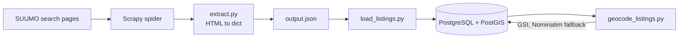

[README.md](https://github.com/user-attachments/files/33986147/README.md)
# Kansai Apartment Map

A data pipeline that collects rental listings for the Kansai region of Japan from SUUMO, stores them in PostgreSQL with PostGIS, and geocodes each address so listings can be shown and filtered on a map.

> **Status: work in progress.** The pipeline (crawl, extract, load, geocode) works and is covered by tests. The map front end and the nearby-amenity step (supermarkets, bus stops, and so on) are not built yet.

## Why this exists

Japanese rental listings give a text address, not coordinates, and the costs that matter when comparing apartments (security deposit 敷金, key money 礼金, management fee) are scattered across the page. This project turns each listing into one structured row with a real location, so those costs and features can be compared on a map.

## What works today

- Crawls SUUMO search-result pages and listing detail pages with Scrapy, one request at a time with a randomized delay.
- Extracts 30+ fields per listing: rent, management fee, deposit and key money (as yen and as months of rent), layout, size, floor, build year, nearest stations with walking time, stove type (IH, gas-ready), pets negotiable, fixed-term lease, and more.
- Loads listings into PostGIS with upserts, so re-crawling updates existing rows instead of duplicating them.
- Geocodes addresses using the Geospatial Information Authority of Japan (GSI) address search, with OpenStreetMap Nominatim as an optional fallback.
- 45 passing tests that run offline, with no network or database needed.

## How it fits together



## Design decisions

- **Extraction reads labels, not CSS classes.** `extract.py` finds a field by the human-facing label next to it (for example 所在地) because labels change less often than class names. All knowledge of SUUMO's markup lives in this one file.
- **Extraction is a pure function.** HTML text goes in and a dict comes out, with no network or Scrapy involved. That is what makes the offline tests possible, and a page the extractor cannot read fails loudly and is counted in the crawl stats instead of being silently dropped.
- **Loads are all-or-nothing.** Each load runs in one transaction. Rows outside Kansai are rejected with a printed reason instead of crashing the run.
- **Re-crawls are safe.** Listings are upserted by their SUUMO unit ID, and every scraped record is also appended to a `raw_listings_archive` JSONB table, so a mapping bug can be fixed by reprocessing the archive instead of crawling again.
- **Delisting is explicit.** `--delist-stale` is opt-in, because after a capped or interrupted crawl "not seen" does not mean "rented out."
- **Geocoding records how good each pin is.** `geocode_source` is `gsi`, `gsi_town` (only the town matched, so the pin is less precise) or `nominatim`. Failed attempts set `geocode_attempted_at` with no location, and later runs skip them unless `--retry-failed` is passed.
- **A wrong pin is worse than no pin.** A geocoding result is discarded unless its name contains the listing's own city and ward (so 北区 cannot silently resolve to Kyoto's or Sakai's) and it falls inside a Kansai bounding box. A test also checks that latitude and longitude are not swapped.
- **The schema changes only through migrations.** Every change is a `node-pg-migrate` file with a working `down`, so any environment ends up with the same structure and the history is in version control.
- **Conventional Commits** are enforced with commitlint and husky.

## Data model

| Table | Purpose |
|---|---|
| `listings` | One row per listing: costs, layout, features, status, and a PostGIS `geography(Point, 4326)` column with a GiST index |
| `agencies` | Listing agencies, upserted by Japanese name |
| `listing_amenity_distances` | Nearby stations with walking time (other amenity types are planned) |
| `raw_listings_archive` | Raw scraped records as JSONB, for reprocessing |

## Getting started

Requires Docker, Node.js, and Python 3.

```bash
# 1. Configuration
cp .env.example .env            # then edit the values

# 2. Database (PostgreSQL 16 + PostGIS)
docker compose --env-file .env -f infra/docker-compose.yml up -d

# 3. Schema
cd infra
npm install
npx node-pg-migrate up --envPath ../.env

# 4. Python dependencies
pip install scrapy parsel requests "psycopg[binary]" python-dotenv pytest

# 5. Crawl, load, geocode
cd suummoListingScraper
scrapy crawl suummo             # writes output.json
python load_listings.py
python geocode_listings.py --limit 20
```

The crawl targets the areas listed in `infra/suummoListingScraper/areas.json`. It currently contains one ward (Osaka City, Kita-ku) capped at two search pages. To use the Nominatim fallback, set `NOMINATIM_CONTACT` in `.env` to an email or URL that identifies you, as its usage policy requires.

## Tests

```bash
cd infra/suummoListingScraper
python -m pytest tests -v
```

The tests cover field extraction against saved listing pages (including both deposit and key-money cases), the loader's row mapping, and the geocoder's safety checks. Three tests are skipped unless you keep full-page fixtures locally, which are git-ignored.

## Project layout

```
infra/
  docker-compose.yml           PostGIS database
  migrations/                  schema, as node-pg-migrate files
  suummoListingScraper/
    areas.json                 what to crawl
    kansai_scraper/            Scrapy project (spider, extract.py)
    load_listings.py           output.json -> Postgres
    geocode_listings.py        addresses -> coordinates
    tests/                     offline tests and trimmed fixtures
```

## Roadmap

- Nearby amenity distances (supermarkets, bus stops, and similar) for each listing
- Map front end with filters on cost and features
- More areas beyond Osaka's Kita-ku

## Progress log

This README is updated as each major step lands.

| Date | Milestone |
|---|---|
| 2026-10-24 | Geocoding: addresses are resolved through GSI with a Nominatim fallback, with provenance and failure tracking recorded per listing |
| 2026-10-21 | Loader: scraped listings are upserted into Postgres, with a raw JSONB archive and optional delisting of stale listings |
| 2026-10-19 | Extraction: listing detail pages are parsed into structured fields, with offline tests |
| 2026-10-14 | Scrapy spider scaffolded with throttling; PostGIS database and initial schema migrations added |
| 2026-10-01 | Repository created; commit linting enforced with commitlint and husky |

## About

A personal project, not affiliated with SUUMO. Crawls are throttled (one request at a time, randomized delay, AutoThrottle) and capped by `max_pages`.
