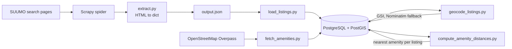

# Kansai Apartment Map

A data pipeline that collects rental listings for the Kansai region of Japan from SUUMO, stores them in PostgreSQL with PostGIS, and geocodes each address so listings can be shown and filtered on a map.

> **Status: work in progress.** The pipeline (crawl, extract, load, geocode, nearby-amenity distances) works and is covered by tests. The map front end and routed walking times are not built yet.

## Why this exists

Japanese rental listings give a text address, not coordinates, and the costs that matter when comparing apartments (security deposit 敷金, key money 礼金, management fee) are scattered across the page. This project turns each listing into one structured row with a real location, so those costs and features can be compared on a map.

## What works today

- Crawls SUUMO search-result pages and listing detail pages with Scrapy, one request at a time with a randomized delay.
- Extracts 30+ fields per listing: rent, management fee, deposit and key money (as yen and as months of rent), layout, size, floor, build year, nearest stations with walking time, stove type (IH, gas-ready), pets negotiable, fixed-term lease, and more.
- Loads listings into PostGIS with upserts, so re-crawling updates existing rows instead of duplicating them.
- Geocodes addresses using the Geospatial Information Authority of Japan (GSI) address search, with OpenStreetMap Nominatim as an optional fallback.
- Downloads supermarkets, convenience stores, ramen restaurants, bus stops and schools from OpenStreetMap, then finds the nearest one of each for every listing within 2 km. The walking time is an estimate for now.
- 55 passing tests: 53 run offline, and 2 need a database.

## How it fits together



## Design decisions

- **Extraction reads labels, not CSS classes.** `extract.py` finds a field by the human-facing label next to it (for example 所在地) because labels change less often than class names. All knowledge of SUUMO's markup lives in this one file.
- **Extraction is a pure function.** HTML text goes in and a dict comes out, with no network or Scrapy involved. That is what makes the offline tests possible, and a page the extractor cannot read fails loudly and is counted in the crawl stats instead of being silently dropped.
- **Loads are all-or-nothing.** Each load runs in one transaction. Rows outside Kansai are rejected with a printed reason instead of crashing the run.
- **Re-crawls are safe.** Listings are upserted by their SUUMO unit ID, and every scraped record is also appended to a `raw_listings_archive` JSONB table, so a mapping bug can be fixed by reprocessing the archive instead of crawling again.
- **Delisting is explicit.** `--delist-stale` is opt-in, because after a capped or interrupted crawl "not seen" does not mean "rented out."
- **Geocoding records how good each pin is.** `geocode_source` is `gsi`, `gsi_town` (only the town matched, so the pin is less precise) or `nominatim`. Failed attempts set `geocode_attempted_at` with no location, and later runs skip them unless `--retry-failed` is passed.
- **A wrong pin is worse than no pin.** A geocoding result is discarded unless its name contains the listing's own city and ward (so 北区 cannot silently resolve to Kyoto's or Sakai's) and it falls inside a Kansai bounding box. A test also checks that latitude and longitude are not swapped.
- **Amenities are downloaded once and measured locally.** Asking OpenStreetMap about each listing separately would mean thousands of requests to a free public service. Instead each category is downloaded once into the `amenities` table, and PostGIS finds the nearest one per listing in a single query. A failed download never wipes the data already stored.
- **Estimated numbers are labelled.** Walking minutes are straight-line distance x 1.3, at 80 m per minute (the Japanese real-estate convention). Each row stores `method = 'straight_line_estimate'`, so routed times can replace them later without guessing which rows are which. No row for a category means nothing is mapped within 2 km.
- **Schools come from OpenStreetMap, which is noisy.** Some entries tagged as schools are cram schools or studios. The school level tag is kept in `amenities.tags` so a later filter can restrict to real elementary, junior high and high schools.
- **The schema changes only through migrations.** Every change is a `node-pg-migrate` file with a working `down`, so any environment ends up with the same structure and the history is in version control.
- **Conventional Commits** are enforced with commitlint and husky.

## Data model

| Table | Purpose |
|---|---|
| `listings` | One row per listing: costs, layout, features, status, and a PostGIS `geography(Point, 4326)` column with a GiST index |
| `agencies` | Listing agencies, upserted by Japanese name |
| `listing_amenity_distances` | Nearest station (walking time from the listing page) and nearest amenity of each category, with a `method` column saying how the number was produced |
| `amenities` | OpenStreetMap shops, bus stops, ramen restaurants and schools as PostGIS points, with a GiST index |
| `raw_listings_archive` | Raw scraped records as JSONB, for reprocessing |

## Getting started

Requires Docker, Node.js, and Python 3.

```bash
# 1. Configuration
cp .env.example .env            # then edit the values

# 2. Database (PostgreSQL 16 + PostGIS)
docker compose --env-file .env -f infra/docker-compose.yml up -d

# 3. Schema
cd infra
npm install
npx node-pg-migrate up --envPath ../.env

# 4. Python dependencies
pip install scrapy parsel requests "psycopg[binary]" python-dotenv pytest

# 5. Crawl, load, geocode, measure amenities
cd suummoListingScraper
scrapy crawl suummo             # writes output.json
python load_listings.py
python geocode_listings.py --limit 20
python fetch_amenities.py       # downloads from OpenStreetMap, takes a few minutes
python compute_amenity_distances.py
```

The crawl targets the areas listed in `infra/suummoListingScraper/areas.json`. It currently contains one ward (Osaka City, Kita-ku) capped at two search pages. To use the Nominatim fallback, set `NOMINATIM_CONTACT` in `.env` to an email or URL that identifies you, as its usage policy requires. `OVERPASS_URL` and `OVERPASS_CONTACT` are optional settings for the amenity download.

## Tests

```bash
cd infra/suummoListingScraper
python -m pytest tests -v
```

The tests cover field extraction against saved listing pages (including both deposit and key-money cases), the loader's row mapping, the geocoder's safety checks, and the parsing and retry logic for the OpenStreetMap download. Three tests are skipped unless you keep full-page fixtures locally, which are git-ignored.

Two more tests check the nearest-amenity SQL against a real PostGIS database. They are skipped unless you opt in, and they use temporary tables, so they are safe on a dev database:

```bash
export TEST_DATABASE_URL="$(grep '^DATABASE_URL=' ../../.env | cut -d= -f2-)"
python -m pytest tests/test_amenity_sql.py -v
```

## Project layout

```
infra/
  docker-compose.yml           PostGIS database
  migrations/                  schema, as node-pg-migrate files
  suummoListingScraper/
    areas.json                 what to crawl
    kansai_scraper/            Scrapy project (spider, extract.py)
    load_listings.py           output.json -> Postgres
    geocode_listings.py        addresses -> coordinates
    fetch_amenities.py         OpenStreetMap -> amenities table
    compute_amenity_distances.py   nearest amenity per listing
    tests/                     offline tests, database tests, and trimmed fixtures
```

## Roadmap

- Routed walking times (OSRM) to replace the straight-line estimates
- Map front end with filters on cost and features
- More areas beyond Osaka's Kita-ku

## Progress log

This README is updated as each major step lands.

| Date | Milestone |
|---|---|
| 2026-11-07 | Amenity distances: shops, bus stops, ramen restaurants and schools are downloaded from OpenStreetMap, and each listing stores its nearest one of each category within 2 km, with the walking time marked as an estimate |
| 2026-10-24 | Geocoding: addresses are resolved through GSI with a Nominatim fallback, with provenance and failure tracking recorded per listing |
| 2026-10-21 | Loader: scraped listings are upserted into Postgres, with a raw JSONB archive and optional delisting of stale listings |
| 2026-10-19 | Extraction: listing detail pages are parsed into structured fields, with offline tests |
| 2026-10-14 | Scrapy spider scaffolded with throttling; PostGIS database and initial schema migrations added |
| 2026-10-01 | Repository created; commit linting enforced with commitlint and husky |

## About

A personal project, not affiliated with SUUMO. Crawls are throttled (one request at a time, randomized delay, AutoThrottle) and capped by `max_pages`. Amenity data is from OpenStreetMap contributors, available under the Open Database Licence.
